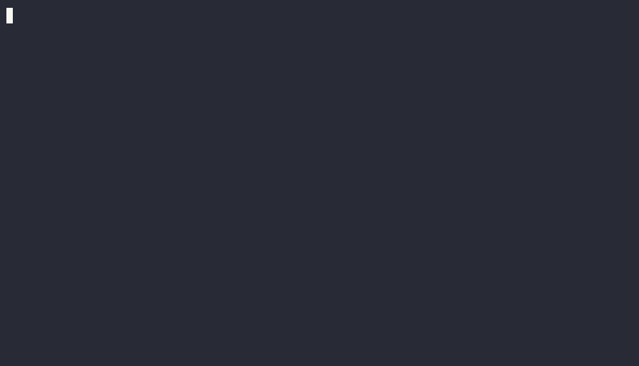

# GitHub Activity Feed

[](client/go.mod)
[](package.json)
[](LICENSE)

<!-- Los badges de CI y de release esperan a que el repositorio sea público:
     shields y el endpoint de Actions responden "repo not found" contra un repo
     privado. Descomentar las dos líneas al cambiar la visibilidad.
[](https://github.com/AG2904/github-activity-feed/actions/workflows/ci.yml)
[](https://github.com/AG2904/github-activity-feed/releases/latest)
-->



Grabación real de punta a punta: el relay con una base temporal, los payloads de
[`docs/demo/`](docs/demo/) —dos capturados de github.com y un cierre derivado de
ellos— reenviados con su firma, y el binario compilado. El `.cast` del que sale el GIF
está versionado al lado.

Un sistema que convierte las entregas críticas de GitHub en una fuente de actividad
para un equipo de desarrollo, y un CLI que la muestra en la terminal.

El proyecto tiene dos mitades que hablan el mismo contrato:

- **El relay** (`src/`, NestJS + SQLite) recibe los webhooks firmados de GitHub,
  decide qué eventos son críticos, los guarda y los emite en vivo por SSE.
- **El CLI** (`client/`, Go) se conecta al relay y muestra los eventos en la terminal,
  o consulta el historial almacenado.

Cuatro eventos son críticos, y cada uno tiene su tarjeta en el feed:

| Tipo | Cuándo | Tarjeta |
| --- | --- | --- |
| `pr.merged` | un pull request fusionado a `main` | `maria.perez merged fix/memory-leak into main` |
| `issue.assigned` | un issue con `bug` o `feedback` que se asigna | `lucia.gomez assigned to tomas.ferreira` |
| `issue.closed` | ese issue que se cierra como resuelto | `lucia.gomez closed` |
| `issue.dismissed` | ese issue que se cierra como `not_planned` | `lucia.gomez dismissed as not planned` |

Todo lo demás se acusa y se descarta. El cierre se separa por el motivo que reporta
GitHub —resuelto o descartado—, así que la terminal no mezcla un bug arreglado con uno
que se decidió no hacer. El relay es la memoria compartida del equipo; el CLI es la
vista de cada desarrollador.

La justificación del diseño, el contrato y el estado del proyecto están en
[`ARCHITECTURE.md`](ARCHITECTURE.md).

## Requisitos

| Herramienta | Versión | Para qué |
| --- | --- | --- |
| Node.js | 24 (la versión que apuntan los tipos de las dependencias) | el relay |
| Go | 1.27 (`client/go.mod` declara `go 1.27.0`) | el CLI |

Ninguno de los dos es obligatorio si se usa el camino dockerizado: véase
[Todo junto en Docker](#todo-junto-en-docker).

## Relay: arranque rápido

1. Copiar la plantilla de variables de entorno y completar el secreto:

   ```powershell
   Copy-Item .env.example .env
   ```

   En `.env`, reemplazar `change-me` por un secreto largo. `GITHUB_WEBHOOK_SECRET` es
   obligatoria: sin ella el relay se niega a arrancar. `.env` está en `.gitignore` y
   nunca se versiona.

2. Instalar las dependencias:

   ```powershell
   npm ci
   ```

3. Arrancar el relay:

   ```powershell
   npm start
   ```

   El relay carga `.env` al arrancar. Las variables exportadas en la shell tienen
   prioridad sobre el archivo, así que cualquiera puede sobrescribirse sin editar el
   archivo. El proceso escucha en el puerto `3000`, o en el que indique la variable
   `PORT`.

4. Confirmar que responde:

   ```powershell
   Invoke-WebRequest http://localhost:3000/history -UseBasicParsing
   ```

   Con la base vacía, el cuerpo es:

   ```json
   []
   ```

   El historial vive en `relay.db` (o en la ruta de `DATABASE_PATH`). Las rutas
   `POST /` (webhooks), `GET /history` y `GET /stream` (SSE) son las únicas del relay.

## CLI: arranque rápido

1. Compilar el binario. El bloque siguiente se ejecuta desde la raíz del repositorio y
   la opción integrada en npm deja el binario de la plataforma anfitriona en
   `client/dist/`:

   ```powershell
   npm run cli:build
   ```

   La salida nombra el archivo producido, por ejemplo
   `feed: dist/feed-windows-amd64.exe  windows/amd64  1.0.0+<commit>`.

   Como alternativa se puede compilar directamente con Go. Este segundo camino se
   queda en `client\` para compilar y para ejecutar. En Windows el nombre del
   ejecutable debe incluir la extensión:

   ```powershell
   cd client
   go build -o feed.exe ./cmd/feed
   ```

2. Con el relay en marcha, escuchar los eventos en vivo. El comando depende del camino
   de compilación y cada bloque indica desde dónde se ejecuta.

   Opción npm, desde la raíz del repositorio:

   ```powershell
   .\client\dist\feed-windows-amd64.exe watch --relay http://localhost:3000
   ```

   Opción Go, desde `client\`, el directorio en el que quedó la shell tras el `cd client`
   del paso 1:

   ```powershell
   .\feed.exe watch --relay http://localhost:3000
   ```

3. Qué se ve. Los eventos van a **stdout**; la narración de la sesión va a **stderr**:

   - stdout: una tarjeta por evento, por ejemplo
     `maria.perez merged fix/memory-leak into main` o
     `lucia.gomez dismissed as not planned`, con el título, las etiquetas, el
     repositorio, el tiempo relativo y la URL.
   - stderr: el banner `watching <url>/stream · backfill <n>`, la línea `connected · …`,
     los avisos de reconexión y la línea `stopped · …` al salir con `Ctrl-C`.
     `<url>` es la base del relay: el CLI le agrega `/stream` para abrir el stream. Con
     los filtros locales, el banner suma ` · user <login>` y ` · repo <owner/name>`
     (véase [`docs/cli-testing.md`](docs/cli-testing.md)).

   Esa separación es deliberada: `feed watch | jq` recibe solo eventos.

4. Para ver el contrato sin formato, una línea JSON por evento, tal como lo emite el
   relay. Con el binario de npm, desde la raíz del repositorio:

   ```powershell
   .\client\dist\feed-windows-amd64.exe watch --relay http://localhost:3000 --json
   ```

   Con el binario de Go, el mismo comando se escribe `.\feed.exe …` dentro de `client\`.

5. Para consultar lo ya almacenado:

   ```powershell
   .\client\dist\feed-windows-amd64.exe history --relay http://localhost:3000 --json
   ```

   Desde `client\` con el binario de Go, el equivalente es
   `.\feed.exe history --relay http://localhost:3000 --json`.

   Contra un relay recién iniciado, la salida es `[]`. Sin `--json`, el historial se
   muestra con las mismas tarjetas del modo en vivo.

### Instalarlo como comando

Los pasos de arriba invocan el binario por su ruta, porque recién compilado todavía
no es un comando. Para tener `feed` a secas, como en la grabación del principio:

```powershell
npm.cmd run cli:install
```

Compila el binario del host y lo copia a `~/bin/feed.exe` (o `~/bin/feed` en
Linux y macOS). El script no agrega nada al `PATH`, no pide permisos y no
sobrescribe un `feed` que no haya compilado él mismo: si encuentra otro archivo con
ese nombre, se niega y pide `--force`. Y si ese archivo es un enlace —duro o
simbólico— se niega siempre, incluso con `--force`: reemplaza archivos, nunca escribe
a través de un enlace hacia otro lado. Desinstalarlo es borrar ese archivo.

Con `~/bin` en el `PATH`, el resto de esta guía funciona igual reemplazando la ruta
por `feed`:

```powershell
feed watch --relay http://localhost:3000
```

El flujo completo —firma del webhook incluida— está en
[`docs/end-to-end-testing.md`](docs/end-to-end-testing.md).

## Todo junto en Docker

Para no instalar Node, Go ni SQLite, los dos procesos caben en dos imágenes:

```bash
cp .env.example .env      # y reemplazar `change-me` por un secreto real
docker compose up -d --build relay
docker compose run --rm feed watch
```

El relay queda en `127.0.0.1:3000` con el SQLite sobre un volumen, así que el
historial sobrevive a los reinicios. Las versiones de Node y Go están fijadas a
releases parcheados y la tabla de por qué está en [`docs/docker.md`](docs/docker.md).

## Contrato y runbooks

El contrato es único y no se duplica en este documento. La forma canónica de nueve
campos, con el significado de cada uno, está en
[`ARCHITECTURE.md` §6](ARCHITECTURE.md#6-contrato-de-datos-común-activityevent).

Los recorridos operativos:

- [`docs/manual-testing.md`](docs/manual-testing.md) — el relay solo, paso a paso,
  incluido el envío de un webhook firmado.
- [`docs/cli-testing.md`](docs/cli-testing.md) — el CLI solo: comandos, códigos de
  salida, color, filtros locales y reconexión.
- [`docs/end-to-end-testing.md`](docs/end-to-end-testing.md) — relay y CLI juntos,
  desde el webhook hasta la terminal.
- [`docs/exposing-the-relay.md`](docs/exposing-the-relay.md) — cómo exponer el relay
  con un túnel para recibir webhooks reales de GitHub, con sus límites medidos.
- [`docs/docker.md`](docs/docker.md) — los dos procesos en contenedores, con las
  versiones fijadas y su justificación.

## Estado de las fases

El plan por fases está en [`ARCHITECTURE.md` §7](ARCHITECTURE.md#7-plan-de-implementación-por-fases).

- **Fase 1 — el relay:** completa. Ingesta firmada, filtro de eventos críticos,
  idempotencia por entrega, stream SSE e historial.
- **Fase 2 — el CLI:** completa. `watch` y `history`, filtros locales, renderizado en
  tarjetas y binarios estáticos para cuatro plataformas.
- **Fase 3 — validación y demo:** completa. CI en GitHub Actions en cada push a
  `main` y en cada PR, los binarios publicados en el
  [release `v1.0.0`](https://github.com/AG2904/github-activity-feed/releases/tag/v1.0.0),
  el camino dockerizado (ADR-0014) y una demostración con payloads reales de GitHub.
  El despliegue del relay en un servidor interno sigue siendo opcional y no bloquea el
  cierre de la fase.

Fuera de alcance en esta fase: automatización de despliegue, proxies inversos y TLS;
empaquetado con goreleaser o instaladores; publicación de las imágenes en un registry;
cambios al formato de cable más allá de los cuatro tipos de evento ya implementados;
autenticación multiusuario, permisos, monitoreo, métricas y alertas. El despliegue del
relay en un servidor interno es opcional y no bloquea el cierre de la fase.

## Seguridad y contribución

Las reglas para contribuir están en [`CONTRIBUTING.md`](CONTRIBUTING.md); cómo reportar
una vulnerabilidad, en [`SECURITY.md`](SECURITY.md).
